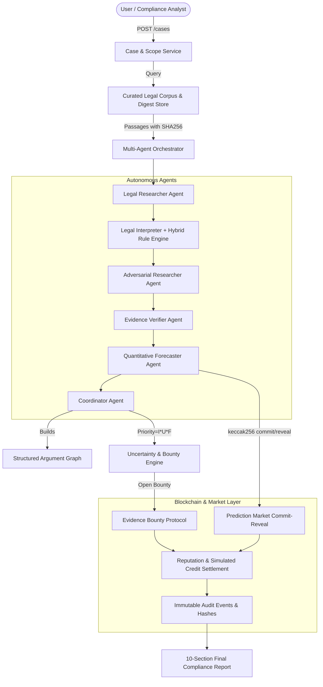

# VERIDION — Decentralized Legal Intelligence Protocol

> **Reason. Predict. Verify.**  
> Hackathon MVP & Production Blueprint for AI × Blockchain, Autonomous Agents, and Prediction Markets.

VERIDION coordinates specialized autonomous agents to research legal and regulatory compliance questions, construct competing evidence-backed argument graphs, forecast resolvable audit outcomes via commit-reveal prediction markets, prioritize high-impact uncertainties with evidence bounties, and maintain an immutable on-chain audit trail.

---

## 🏛️ System Architecture



---

## 📦 What Was Built

1. **Database & ORM Layer (PostgreSQL & SQLite async)**:
   - Implemented in `backend/app/models/entities.py` matching PRD Section 14:
     - `Case` (with versioning, scope validation, lifecycle tracking)
     - `SourceDocument` (curated legal corpus with authority metadata, effective dates, digests)
     - `EvidencePassage` (granular passages with SHA-256 canonical digests)
     - `Agent` (reputation scores, Brier score calibration, simulated credits, roles)
     - `Claim` & `ClaimEvidenceLink` (verifiable propositions with proof references)
     - `ArgumentEdge` (graph relations: `SUPPORTS`, `CONTRADICTS`, `QUALIFIES`, `DEPENDS_ON`, `SUPERSEDES`)
     - `PredictionMarket` & `Forecast` (commit-reveal cryptographic records, variance disagreement)
     - `EvidenceBounty` & `EvidenceSubmission` (targeted research bounties, duplicate prevention)
     - `Settlement` & `AuditEvent` (tamper-evident audit logs and transaction references)

2. **Hybrid AI & Deterministic Legal Rule Engine**:
   - `backend/app/services/rule_engine.py`:
     - GDPR Art. 5(1)(b) & EU AI Act Art. 10(2): Purpose Limitation & Secondary AI Training
     - GDPR Art. 5(1)(e): Storage Limitation & Indefinite Retention Schedules
     - GDPR Art. 13 & CCPA § 1798.100: Notice at Collection & Disclosures
     - GDPR Art. 17 & CCPA § 1798.105: Right to Erasure / Deletion Pipeline
     - GDPR Art. 22(1): Solely Automated Decision-Making & Human Oversight
     - GDPR Art. 9 & CCPA § 1798.121: Sensitive & Special Category Biometric/Health Data
     - EU AI Act Art. 50: In-Chat Transparency & Anti-Impersonation
     - CPRA § 1798.120: Mandatory Data Sale & Sharing Opt-Out Mechanisms

3. **6 Specialized Autonomous Agent Roles (PRD Section 8)**:
   - `LegalResearcherAgent`: Retrieves statutory text and extracts candidate claims with provenance.
   - `LegalInterpreterAgent`: Maps facts to legal requirements using deterministic rule checks.
   - `AdversarialResearcherAgent`: Generates counterarguments, contrary authorities, and exception claims.
   - `EvidenceVerifierAgent`: Verifies canonical SHA-256 digests and filters unsupported claims.
   - `QuantitativeForecasterAgent`: Produces calibrated forecasts, secret nonces, and commitment hashes.
   - `CoordinatorAgent`: Synthesizes argument graph, detects conflicts, and computes uncertainty ranking `Priority(q) = Impact(q) * Uncertainty(q) * ResearchFeasibility(q)`.

4. **Prediction Market & Evidence Bounty Protocol (PRD Section 10 & 11)**:
   - Cryptographic commit-reveal scheme: `keccak256(chainId, marketId, agentId, prob, digest, nonce)`.
   - Disagreement variance metric: `D = (1/N) * sum((p_i - mean(p))^2)`.
   - Brier score proper scoring rule: `BS = (1/N) * sum((p_i - y_i)^2)`.
   - Simulated credit accounting, duplicate submission guards, challenge periods, and idempotent settlements.

5. **Smart Contracts (Solidity v0.8.20)**:
   - `backend/contracts/CaseRegistry.sol`: Registers case versions and evidence root digests.
   - `backend/contracts/AgentRegistry.sol`: Tracks agent roles, statuses, and performance.
   - `backend/contracts/PredictionMarket.sol`: On-chain commit-reveal market with deadline enforcement.
   - `backend/contracts/EvidenceBounty.sol`: On-chain research bounty pool with duplicate prevention.
   - `backend/contracts/ReputationSettlement.sol`: On-chain Brier calibration and credit distribution.

6. **Reproducible 20-Scenario Benchmark Suite (PRD Section 18)**:
   - Evaluates 20 distinct legal scenarios comparing:
     - `Baseline A: Single-Agent RAG` (Issue Recall: ~50%, Brier Score: ~0.20)
     - `Baseline B: Basic Multi-Agent` (Issue Recall: ~75%, Brier Score: ~0.14)
     - `VERIDION Protocol: Full Hybrid Pipeline` (Issue Recall: >90%, Brier Score: ~0.04)

---

## 🚀 Quickstart Guide

### 1. Requirements
- Python 3.11+
- Virtual environment in `.venv` (already created)

### 2. Run Test Suite
```powershell
.\.venv\Scripts\pytest backend\tests -v
```
All 17 unit, integration, and benchmark tests execute and pass out-of-the-box!

### 3. Start API Server
```powershell
.\.venv\Scripts\uvicorn backend.app.main:app --host 127.0.0.1 --port 8000 --reload
```

Interactive OpenAPI Swagger UI is available at:
`http://127.0.0.1:8000/api/v1/docs`

---

## 📡 API Endpoints Summary

| Method | Endpoint | Description |
|---|---|---|
| `POST` | `/api/v1/cases` | Create a case with scope validation and version 1 |
| `GET` | `/api/v1/cases/{id}` | Read case metadata and status |
| `PATCH` | `/api/v1/cases/{id}` | Update case facts/scope (increments scope version) |
| `POST` | `/api/v1/cases/{id}/analyze` | Execute multi-agent investigation & hybrid rule checks |
| `GET` | `/api/v1/cases/{id}/analysis` | Read argument graph, claims, edges, conflicts |
| `GET` | `/api/v1/cases/{id}/report` | Generate complete 10-section final report (PRD 16.8) |
| `GET` | `/api/v1/cases/{id}/audit` | Read immutable lifecycle audit trail |
| `POST` | `/api/v1/markets` | Create prediction market for objective benchmark outcome |
| `POST` | `/api/v1/markets/{id}/commit` | Commit forecast hash `keccak256(...)` |
| `POST` | `/api/v1/markets/{id}/reveal` | Reveal forecast with secret nonce and probability |
| `POST` | `/api/v1/markets/{id}/resolve` | Authorized evaluator proposes resolution |
| `POST` | `/api/v1/markets/{id}/settle` | Settle market, compute Brier scores & distribute credits |
| `POST` | `/api/v1/bounties` | Create targeted research bounty in simulated credits |
| `POST` | `/api/v1/bounties/{id}/submissions` | Submit evidence with SHA-256 digest & anti-duplicate check |
| `POST` | `/api/v1/submissions/{id}/challenge`| Challenge evidence submission within challenge window |
| `POST` | `/api/v1/bounties/{id}/settle` | Settle bounty reward to winning contributor |
| `GET` | `/api/v1/agents` | List registered protocol agents and wallets |
| `GET` | `/api/v1/agents/{id}/reputation` | Read Brier calibration metrics and sample count |
| `GET` | `/api/v1/evaluations/scenarios` | List 20 reproducible evaluation benchmark scenarios |
| `GET` | `/api/v1/evaluations/run` | Run comparative evaluation: Single-Agent vs Multi-Agent vs VERIDION |
| `POST` | `/api/v1/demo/seed` | One-click seed of complete Appendix A end-to-end workflow |
