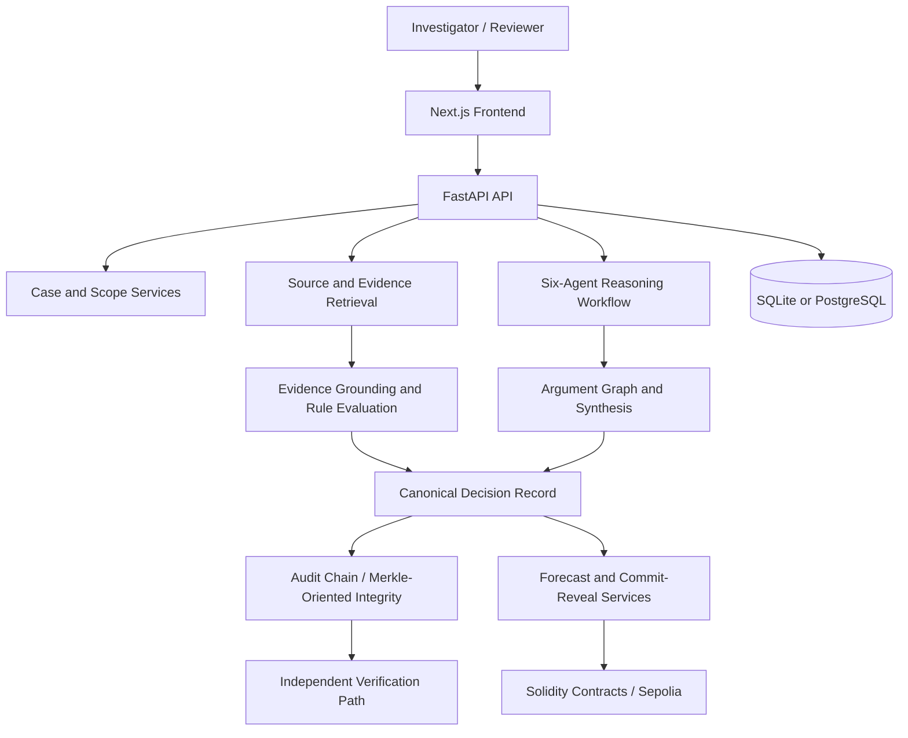

<div align="center">

# VERDION

### Reason. Predict. Verify.

**Auditable Regulatory Decision Infrastructure**

Evidence-grounded legal research · Multi-agent analysis · Structured forecasting · Cryptographic verification · Ethereum testnet integration

[Live application](https://verdion.vercel.app/landing) · [Source repository](https://github.com/harshitrajj23/Verdion) · [Security policy](SECURITY.md) · [Code of conduct](CODE_OF_CONDUCT.md) · [License](LICENSE)

[](https://github.com/harshitrajj23/Verdion/actions/workflows/ci.yml)
[](LICENSE)
[](https://www.python.org/)
[](https://nextjs.org/)
[](https://soliditylang.org/)

</div>

---

> **Project status:** VERDION is an engineering and research prototype. Its interfaces, services, benchmark artifacts and Sepolia contracts are intended for inspection and experimentation—not as a certified legal product, production financial system, or substitute for professional legal advice.

## 1. What is VERDION?

VERDION explores a central question: **what would it take for an AI-assisted regulatory decision to be inspectable, evidence-linked and independently checkable—not merely persuasive?**

Conventional generative systems can produce fluent legal-sounding answers while concealing uncertainty, weak source attribution, conflicting interpretations or changes to the underlying record. VERDION takes a different architectural approach: structure the inquiry, associate claims with evidence, separate reasoning responsibilities, represent disagreement, expose forecasting assumptions and preserve integrity information for later verification.

The project is organised around **Option C — Auditable Regulatory Decision Infrastructure**. Legal research and interpretation, adversarial analysis and probabilistic forecasting are capabilities within that wider evidence-to-decision workflow.

### Design principles

- **Evidence before conclusions.** Material claims should be traceable to identified sources and passages.
- **Scope before analysis.** A case starts with an explicit question, jurisdiction and fact pattern.
- **Disagreement is information.** Competing interpretations should be visible rather than silently averaged away.
- **Uncertainty is explicit.** Forecasts are probabilistic outputs, not declarations of legal truth.
- **Integrity is testable.** Canonical records and cryptographic digests support checks for unintended modification.
- **Human review remains necessary.** The system supports investigation; it does not replace qualified legal judgment.

## 2. Capabilities

| Area | What the repository implements or demonstrates |
|---|---|
| Regulatory case workspace | Structured case creation, jurisdiction and fact metadata, scope/version handling and case lifecycle APIs. |
| Evidence retrieval | A versioned EU-focused corpus, passage retrieval, source metadata and provenance-oriented records. |
| Multi-agent analysis | Six specialist roles coordinated through the backend reasoning workflow. |
| Legal rules | Deterministic rule evaluation alongside model-assisted analysis paths. |
| Argument graph | Typed relationships including support, contradiction, qualification, dependency and supersession. |
| Evidence grounding | Validation services designed to check citation, passage, jurisdictional and temporal conditions. |
| Decision records | Structured decision representation and export-oriented services. |
| Audit integrity | Hash-linked audit events, canonical serialization, Merkle-oriented records and an independent verification path. |
| Forecasting | Probability outputs, Brier-style scoring utilities and commit/reveal market workflows. |
| Evidence bounties | Structured bounty definitions, submission records, evaluation rubrics and challenge-related contract components. |
| Blockchain integration | Solidity contracts and configuration for Ethereum Sepolia (chain ID `11155111`). |
| Evaluation | Scenario datasets, benchmark runners, baseline comparisons and audit artifacts. |

The repository includes both curated/benchmark data paths and integrations intended for live services. **A screen displaying data is not, by itself, proof that the data came from a live external source or that a transaction occurred.** Inspect the execution mode, record provenance, API response and chain transaction relevant to the specific workflow.

## 3. The six-agent architecture

The application organises analysis into six specialist responsibilities:

1. **Legal Researcher** — locates potentially relevant legal material and supporting passages.
2. **Legal Interpreter** — evaluates how identified provisions relate to the stated facts and inquiry.
3. **Adversarial Researcher** — searches for counterarguments, qualifications and competing interpretations.
4. **Evidence Verifier** — checks evidence references and integrity-related conditions.
5. **Quantitative Forecaster** — produces structured probability estimates for defined events.
6. **Coordinator** — coordinates the workflow and synthesises the outputs into a case-level result.

The intended value is separation of responsibility and inspectability—not a claim that six agents guarantee correctness. Agent output can still be incomplete, correlated, biased or wrong. Model-provider configuration and execution mode matter; when external model credentials or services are unavailable, the codebase includes deterministic/fallback paths. Review the returned execution metadata rather than assuming every run used a remote LLM.

## 4. System architecture



### Main layers

- **Frontend:** Next.js 14, React 18, TypeScript, Tailwind CSS, Viem and Vitest.
- **Backend:** Python 3.11, FastAPI, Pydantic, SQLAlchemy, async SQLite/PostgreSQL drivers and Web3 tooling.
- **Reasoning and data:** agent orchestration, source retrieval, deterministic rules, argument graph, uncertainty and scoring modules.
- **Protocol contracts:** Solidity contracts configured for compiler `0.8.24` and Foundry tests.
- **Shared protocol material:** JSON schemas, canonical digest implementations, rubrics and a threat model.

## 5. Repository map

```text
.
├── backend/
│   ├── app/api/v1/          # FastAPI routes: cases, evidence, agents, audit, markets, etc.
│   ├── app/core/            # Configuration, database and application infrastructure
│   ├── app/models/          # Persistence models
│   ├── app/schemas/         # Request/response and domain schemas
│   ├── app/services/        # Case, agent, grounding, retrieval, decision and audit services
│   └── requirements.txt
├── contracts/
│   ├── src/                 # Solidity contracts
│   ├── test/                # Foundry tests
│   └── foundry.toml
├── frontend/
│   ├── src/app/             # Next.js routes
│   ├── src/components/      # UI components
│   ├── src/lib/             # API, state, types and deployment configuration
│   └── package.json
├── ml/
│   ├── agents/              # Agent orchestration and agent-specific tests
│   ├── retrieval/           # Passage retrieval and isolation
│   ├── rules/               # Deterministic legal rule engine
│   ├── argument_graph/      # Typed argument graph
│   ├── aggregation/         # Scoring and aggregation
│   ├── benchmark/           # Scenarios, evaluation runners and freeze record
│   ├── corpus/              # Source and passage metadata
│   └── llm/                 # Local Ollama client
├── shared/
│   ├── schemas/             # Case, claim, evidence, forecast, bounty and agent schemas
│   ├── src/                 # TypeScript/Python canonical digest utilities
│   ├── rubrics/             # Bounty and market-resolution rubrics
│   └── threat_model.md
├── audit/                   # Dated engineering, benchmark and security audit artifacts
├── frontend-handoff/        # API contract, OpenAPI document, models and examples
├── scripts/                 # Reproduction, verification and audit utilities
├── Dockerfile
├── docker-compose.yml
└── .github/workflows/ci.yml
```

## 6. Run locally

### Prerequisites

- Python **3.11**
- Node.js **18** (the repository CI workflow uses Node 18)
- npm
- Git
- Foundry only if you intend to build and test Solidity contracts
- Ollama or configured external model credentials only if you want that model execution path

### 6.1 Clone the repository

```bash
git clone https://github.com/harshitrajj23/Verdion.git
cd Verdion
```

### 6.2 Configure the backend

Create and activate a virtual environment.

**Windows PowerShell**

```powershell
py -3.11 -m venv .venv
.venv\Scripts\Activate.ps1
python -m pip install --upgrade pip
pip install -r backend/requirements.txt
pip install greenlet
```

**macOS / Linux**

```bash
python3.11 -m venv .venv
source .venv/bin/activate
python -m pip install --upgrade pip
pip install -r backend/requirements.txt
pip install greenlet
```

The backend reads configuration from the repository-root `.env` file. To start from the example configuration:

```bash
# macOS / Linux
cp backend/.env.example .env
```

On Windows PowerShell:

```powershell
Copy-Item backend/.env.example .env
```

Review the copied file before running. Replace placeholder addresses and endpoints with values appropriate to your environment. Keep `DEBUG=true`, wildcard CORS settings, local RPC endpoints and demo credentials confined to local development. Do not put private keys or provider credentials in source control.

### 6.3 Start the backend

From the repository root:

```bash
python -m uvicorn backend.app.main:app --host 127.0.0.1 --port 8000 --reload
```

- Health: `http://127.0.0.1:8000/health`
- OpenAPI / Swagger UI: `http://127.0.0.1:8000/api/v1/docs`
- ReDoc: `http://127.0.0.1:8000/api/v1/redoc`

The default database configuration is local SQLite. PostgreSQL can be selected through `DATABASE_URL` when the corresponding service is available.

### 6.4 Start the frontend

In a second terminal:

```bash
cd frontend
npm ci
npm run dev
```

Open `http://localhost:3000`. The checked-in Next.js rewrite routes `/api/v1/*` to `http://127.0.0.1:8000/api/v1/*`; start the backend first for API-backed functionality.

### 6.5 Optional local model

The root `.env.example` documents the Ollama URL and model variables. The local client defaults to `http://localhost:11434` and `qwen2.5:7b-instruct`. Install and start Ollama separately, pull the model you intend to use, and configure the environment. Model availability, memory requirements and output quality depend on the machine and model selected.

## 7. Smart contracts

The `contracts/` directory contains:

- `AgentRegistry.sol`
- `CaseRegistry.sol`
- `EvidenceBounty.sol`
- `MultiSigPauseController.sol`
- `PredictionMarket.sol`
- `ReputationSettlement.sol`
- `ThresholdEvaluator.sol`

The Foundry configuration uses Solidity `0.8.24`. Compile and run tests:

```bash
cd contracts
forge build --sizes
forge test -vvv --gas-report
```

The frontend deployment configuration identifies Ethereum Sepolia (`chainId: 11155111`) as the reference test network. Contract addresses and deployment metadata are stored in `frontend/src/lib/deployments.json` and backend configuration. Verify the current address, chain ID, bytecode and transaction state independently before interacting with a deployment. Testnet deployments are not mainnet deployments, and testnet balances have no implied monetary value.

## 8. Tests and continuous integration

The checked-in GitHub Actions workflow (`.github/workflows/ci.yml`) defines three CI jobs:

| Job | Current workflow checks |
|---|---|
| Backend | Install Python dependencies, run `pytest backend/tests -v`, and execute the evaluation service. |
| Smart contracts | Install Foundry, run `forge build --sizes`, and execute `forge test -vvv --gas-report`. |
| Frontend | Install with `npm ci`, run `npx vitest run`, and build with `npm run build`. |

Run the corresponding checks locally before proposing a change. A local success is not a substitute for reviewing the CI run on the commit being evaluated.

## 9. Evaluation: read the population, not just the metric

The repository contains benchmark scenarios, runners, raw outputs and dated audit records. Interpret every reported metric together with its dataset, split, seed, baseline, execution mode and audit date.

**Important current benchmark boundary:** `ml/benchmark/FREEZE.md` identifies a 20-scenario set with 14 primary training scenarios and six blind held-out scenarios (`scen_15`–`scen_20`). The freeze record explicitly says the six held-out scenarios were **not run**. Do not describe the full 20-scenario set as a completed 20-case held-out evaluation.

The repository's Phase 5F forecast report also records **zero qualifying resolved external court outcomes (`N = 0`)** in its operational calibration population and distinguishes those from synthetic scoring benchmarks. A synthetic benchmark can test scoring behavior and provide development evidence; it does not establish real-world judicial forecasting accuracy.

The `audit/` directory contains multiple dated engineering and benchmark snapshots. Where figures differ between reports, use the underlying artifact and evaluation population for the exact run being discussed. Do not combine numbers from different snapshots or present synthetic results as observed court outcomes.

## 10. Security, privacy and trust boundaries

Read [`SECURITY.md`](SECURITY.md) and [`shared/threat_model.md`](shared/threat_model.md) before deployment or security-sensitive use.

Key operational rules:

- Never commit `.env`, provider tokens, RPC credentials, wallet private keys, seed phrases or production data.
- Use dedicated test wallets and restricted testnet keys. Never use a local Anvil development key for a real network.
- Treat retrieved legal documents and user-supplied case facts as untrusted input.
- Do not place confidential case facts, personal data or privileged legal material in public blockchain transactions. Hashes and identifiers can still leak correlation or metadata.
- Replace the development credentials and permissive settings in `docker-compose.yml` before any network exposure. The checked-in Compose file is development scaffolding, not a production deployment recipe.
- Configure `DEBUG=false`, explicit CORS origins, production-grade database credentials, TLS, access controls, backups and secret management before deployment.
- Foundry tests and project audit reports are not a substitute for an independent smart-contract audit, penetration test or legal review.

## 11. Responsible use and limitations

VERDION is an experimental decision-support system. It can retrieve incomplete or outdated material, misinterpret a provision, omit relevant authority, produce incorrect probabilities or fail when an external source, RPC endpoint or model provider is unavailable. A cryptographic digest can detect a change relative to a known digest; it cannot prove that the source was authoritative, that a legal interpretation was correct, or that the original data was truthful.

Always:

1. Open and verify primary legal authorities and their current effective versions.
2. Check jurisdiction, date, procedural posture and factual assumptions.
3. Inspect counterarguments and missing-evidence flags.
4. Treat forecasts as experimental estimates, not legal outcomes or financial advice.
5. Obtain qualified human review before relying on an output in a real compliance or legal decision.

The software does not create an attorney-client relationship and does not provide legal, tax, investment or regulatory advice.

## 12. Contributing

Issues and pull requests are welcome. Before contributing:

1. Read [`CODE_OF_CONDUCT.md`](CODE_OF_CONDUCT.md) and [`SECURITY.md`](SECURITY.md).
2. Open an issue for substantial changes so the design can be discussed.
3. Keep changes focused and include tests for behavior changes.
4. Avoid committing secrets, private case data, generated databases, local environment files or large build artifacts.
5. Describe what was changed, why it was changed, how it was tested and any known limitations.

## 13. License

This repository includes an MIT License in [`LICENSE`](LICENSE). The license applies to material for which the project contributors have the rights to grant it. Third-party dependencies, external legal documents, datasets, media assets and trademarks may be subject to separate terms; review their notices and source terms independently. The VERDION name and marks are not granted as trademarks by the software license.

---

<div align="center">

**VERDION — Reason. Predict. Verify.**

Built to make regulatory reasoning more inspectable, evidence-linked and accountable.

</div>
