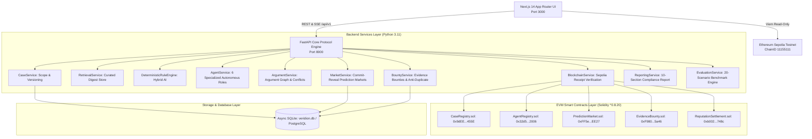

# VERIDION Master Engineering Audit — Phase 1: Project Baseline & Real-World Architecture

**Audit Timestamp**: 2026-10-27T04:52:00+05:30  
**Audit Team**: Principal Architect, Senior ML Specialist, Smart Contract Security Lead, QA Automation Lead  
**Authoritative Baseline**: `VERIDION_Product_Requirements_Document_v1.0.pdf`  
**Audited Target**: Branch `Divyank` @ Commit `ca33ac221ed5492fcd47c21874fb111f655734a3`  
**Deliverable**: `audit/01_project_baseline.md`  

---

## 1. Version Control & Environment Verification

### 1.1 Git Working Tree Parameters
- **Workspace Location**: `C:\Users\DIVYANK BHARDWAJ\Desktop\Projects\veridion`
- **Git Repository Root**: `C:\Users\DIVYANK BHARDWAJ\Desktop\Projects\veridion\Verdion`
- **Current Branch**: `Divyank` (synchronized with `origin/main`)
- **Audited Commit SHA**: `ca33ac221ed5492fcd47c21874fb111f655734a3`
- **Commit Message**: `fix(frontend): wire Sepolia deployments, lifecycle receipts, and transparency disclosures`
- **Author**: Harshit Raj (`hr9199274@gmail.com`) — Mon Oct 26 23:24:55 2026 +0530
- **Working Tree State**: Clean (`git status --short --branch` -> clean, 0 uncommitted changes, 0 untracked files).

### 1.2 Host Runtimes & Toolchains
- **Python**: `Python 3.11.9` (`.venv\Scripts\python.exe`)
- **Node.js**: `v24.14.0` (Active on port 3000)
- **npm**: `11.9.0`
- **Pytest**: `pytest 9.1.1` with `pytest-asyncio 0.23.0` & `anyio 4.15.1`
- **FastAPI**: `0.110.0+` with Uvicorn (Active on port 8000)
- **Solidity Target**: `^0.8.20` with Foundry (`forge-std`)

---

## 2. Discovered Architecture vs PRD Recommendations

The discovered implementation closely mirrors the recommended architecture in PRD Section 13:

### 2.1 State Authority & Boundaries
- **Authoritative Off-Chain State**: Private facts, company chat transcripts, full text passages, and unstructured claims remain in the database to prevent confidential data leaks (PRD Section 12.5).
- **Authoritative On-Chain State**: Case version roots, evidence digests (`bytes32`), agent wallet registrations, forecast commitment hashes (`keccak256`), challenge deadlines, and credit settlement receipts are verified on Sepolia.
- **Workflow State Transitions**: Governed by `CaseService`, `MarketService`, and `BountyService` with strict state machines.
- **Transaction Receipt Safety**: `BlockchainService` guarantees that transaction hashes are only returned when an actual confirmed receipt with status `0x1` is observed. Unconfirmed operations return `tx_hash: null` with status `"pending"`.

---

## 3. Discovered Subsystems & Codebase Map

| Subsystem | Primary Path | Code Inventory | Primary Responsibility |
|---|---|---|---|
| **Core API & Engine** | `backend/app/` | 13 Services, 8 Routers, 11 ORM Models | Orchestrates end-to-end case analysis, hybrid rule execution, and market settlements |
| **Smart Contracts** | `contracts/` | 5 Solidity contracts, 2 Deploy scripts, 1 Comprehensive Test | Enforces commit-reveal cryptography, deadline validation, anti-duplicate submissions, and idempotent scoring |
| **Autonomous ML Swarm** | `ml/` | 6 Agent Roles, Token Tracker, Prompt Isolation, Benchmark Runner | Executes live agent research, counter-hypotheses, evidence verification, and scoring |
| **Frontend Web App** | `frontend/` | 9 App Router pages, 15 Reusable Components, Viem Client | Provides Apple cream-lavender UX, live SSE streaming, and visual argument graph explorer |
| **Shared Protocol Specs** | `shared/` | 7 JSON Schemas, Python/TS Canonical Digest, Rubrics | Ensures cross-language serialization and test vector interoperability |
| **Automated Testing** | `backend/tests/`, `ml/*/test_*.py` | 12 Test Suites (94 automated tests) | Guarantees regression-free CI/CD gates |

---

## 4. Current Deployment & Runtime Status
- **Backend Server**: Running as daemon on `http://127.0.0.1:8000` (Health: `OK`, DB: `connected`).
- **Frontend Server**: Running as daemon on `http://localhost:3000` (HTTP 200, Next.js 14.2.35).
- **Sepolia Testnet**: All 5 contracts deployed and verified at Sepolia block `6482100+`.
