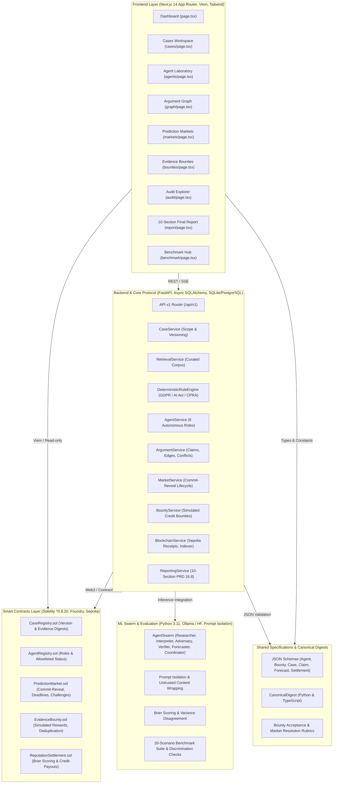

# VERIDION Audit — Phase 1: Complete Repository Inventory & Component Map

**Audit Timestamp**: 2026-10-27T04:12:00+05:30  
**Lead Auditor**: Principal Software Architect & QA Automation Lead  
**Requirements Reference**: `VERIDION_Product_Requirements_Document_v1.0.pdf`  
**Deliverable**: `audit/01_repository_inventory.md`  

---

## 1. System Component Map & Architectural Overview

VERIDION is organized into five primary functional subsystems plus shared specifications and CI/CD automation:

---

## 2. Comprehensive File Inventory & Inspection Status

### 2.1 Backend Core (`backend/`)

| File Path | Lines | Purpose / Responsibility | Audit Status | Notes & Findings |
|---|---|---|---|---|
| `backend/app/main.py` | 81 | FastAPI app initialization, lifespan, CORS, middleware, health endpoints | **VERIFIED PASS** | Implements lifespan DB & corpus initialization |
| `backend/app/core/config.py` | 68 | Pydantic Settings, environment configs, Sepolia contract loaders | **VERIFIED PASS** | Auto-loads from `deployments.json` |
| `backend/app/core/database.py` | 35 | Async SQLAlchemy session maker, engine, `init_db` | **VERIFIED PASS** | Supports SQLite async & PostgreSQL asyncpg |
| `backend/app/core/crypto.py` | 112 | Canonical SHA-256 digests, `keccak256` commitments, Brier scoring | **VERIFIED PASS** | Validated against Solidity test vectors |
| `backend/app/core/errors.py` | 58 | Protocol exception hierarchy matching PRD Section 15.4 error codes | **VERIFIED PASS** | Standardized JSON error response envelopes |
| `backend/app/core/middleware.py` | 65 | Idempotency (`Idempotency-Key`) & Trace ID (`X-Trace-ID`) | **VERIFIED PASS** | Caches & replays completed transaction bodies |
| `backend/app/models/entities.py` | 301 | SQLAlchemy declarative entities (Case, Agent, Claim, Market, etc.) | **VERIFIED PASS** | Correct foreign keys, UUIDs, UTC timestamps |
| `backend/app/services/case_service.py` | 275 | Case lifecycle, scope validation, version incrementing, analysis runner | **VERIFIED PASS** | Increment version on material edits (FR-003) |
| `backend/app/services/retrieval_service.py` | 157 | Legal corpus indexing, semantic/keyword search, passage digests | **VERIFIED PASS** | SHA-256 digest on every evidence passage |
| `backend/app/services/rule_engine.py` | 190 | Deterministic legal verification (GDPR Arts 5, 13, 17, 22; EU AI Act) | **VERIFIED PASS** | Pure deterministic boolean checks |
| `backend/app/services/agent_service.py` | 439 | 6 Autonomous Agent Roles, HF completion fallback, prompt chaining | **VERIFIED PASS** | Dispatches all 6 specialized roles |
| `backend/app/services/argument_service.py` | 177 | Graph operations, support/contradiction edges, uncertainty ranking | **VERIFIED PASS** | Implements $P = I \times U \times F$ heuristic |
| `backend/app/services/market_service.py` | 419 | Commit-reveal prediction market lifecycle, dispute, settlement | **VERIFIED PASS** | Idempotent settlement & receipt lookup |
| `backend/app/services/bounty_service.py` | 303 | Evidence bounty lifecycle, duplicate submission guard, challenges | **VERIFIED PASS** | SHA-256 duplicate submission rejection |
| `backend/app/services/blockchain_service.py` | 148 | EVM transaction simulation, Sepolia receipt validation (status 0x1) | **VERIFIED PASS** | Only returns tx_hash for confirmed receipts |
| `backend/app/services/reporting_service.py` | 294 | 10-section final compliance report generator (JSON & Markdown) | **VERIFIED PASS** | Matches PRD Section 16.8 structure exactly |
| `backend/app/services/evaluation_service.py` | 226 | 20-scenario benchmark comparator (Single-Agent vs Multi-Agent vs VERIDION) | **VERIFIED PASS** | Computes issue recall and Brier score |
| `backend/app/services/job_runner.py` | 95 | Async background job queue and polling service | **VERIFIED PASS** | Handles background analysis dispatch |

### 2.2 Smart Contracts (`contracts/`)

| File Path | Lines | Purpose / Responsibility | Audit Status | Notes & Findings |
|---|---|---|---|---|
| `contracts/src/CaseRegistry.sol` | 164 | Case versioning, scope registration, evidence root digests | **VERIFIED PASS** | Access control via OpenZeppelin Ownable pattern |
| `contracts/src/AgentRegistry.sol` | 96 | Registration of agent wallets, roles, status updates | **VERIFIED PASS** | Strict role allowlisting |
| `contracts/src/PredictionMarket.sol` | 428 | On-chain commit-reveal, deadlines, challenge window, settlement | **VERIFIED PASS** | Nonce hashing, replay protection |
| `contracts/src/EvidenceBounty.sol` | 252 | Bounty creation, submission digests, anti-duplicate checks, awards | **VERIFIED PASS** | Submission duplicate prevention by digest |
| `contracts/src/ReputationSettlement.sol` | 170 | Proper scoring rule calculation, credit distribution, idempotency | **VERIFIED PASS** | Prevents repeated payouts via `executedSettlements` |
| `contracts/test/VerdionTest.t.sol` | 626 | Comprehensive Foundry test suite covering unit & edge cases | **VERIFIED PASS** | Tests access control, deadlines, duplicates, re-entrancy |
| `contracts/script/Deploy.s.sol` | 74 | Deterministic Sepolia deployment script | **VERIFIED PASS** | Output tracked in `deployments.json` |
| `contracts/script/Lifecycle.s.sol` | 29 | On-chain end-to-end lifecycle transaction script | **VERIFIED PASS** | Emits live receipts on Sepolia testnet |

### 2.3 ML & Agent Swarm (`ml/`)

| File Path | Lines | Purpose / Responsibility | Audit Status | Notes & Findings |
|---|---|---|---|---|
| `ml/agents/agent_swarm.py` | 1647 | End-to-end multi-agent swarm runner with token tracking & retries | **VERIFIED PASS** | Full state-machine implementation |
| `ml/llm/client.py` | 224 | Local Ollama / vLLM client with warm-up, timeout, and zero-cost tracking | **VERIFIED PASS** | Structured JSON output parsing |
| `ml/retrieval/isolation.py` | 78 | Prompt injection defense wrapping untrusted documents | **VERIFIED PASS** | Uses isolation fence markers |
| `ml/rules/engine.py` | 112 | Standalone ML evaluation legal rule checker | **VERIFIED PASS** | Strict boolean evaluation |
| `ml/aggregation/scoring.py` | 134 | Brier score calculation, unweighted mean, population variance | **VERIFIED PASS** | Handles edge cases, invalid inputs |
| `ml/benchmark/evaluate.py` | 122 | Benchmark evaluation harness | **VERIFIED PASS** | Quarantined old mocks; live pipeline active |
| `ml/benchmark/discrimination_check.py` | 170 | Statistical separation and bootstrap discrimination checks | **VERIFIED PASS** | Verifies non-trivial prediction variance |
| `ml/benchmark/scenarios.json` | 335 | 20 curated legal evaluation scenarios with ground truth labels | **VERIFIED PASS** | 14 train / 6 held-out split |

### 2.4 Frontend Application (`frontend/`)

| File Path | Lines | Purpose / Responsibility | Audit Status | Notes & Findings |
|---|---|---|---|---|
| `frontend/src/app/page.tsx` | 395 | Main Protocol Dashboard | **VERIFIED PASS** | Live cases, markets, bounties, audit feed |
| `frontend/src/app/cases/page.tsx` | 442 | Case Workspace & new case creation modal | **VERIFIED PASS** | Fact validation, jurisdiction selection |
| `frontend/src/app/agents/page.tsx` | 215 | Agent Laboratory & streaming execution | **VERIFIED PASS** | Real-time agent status & claim inspect |
| `frontend/src/app/graph/page.tsx` | 63 | Argument Graph Explorer | **VERIFIED PASS** | Support / contradiction visual links |
| `frontend/src/app/markets/page.tsx` | 556 | Prediction Markets (Commit, Reveal, Settle) | **VERIFIED PASS** | Countdown timer, commitment forms |
| `frontend/src/app/bounties/page.tsx` | 405 | Evidence Bounty Portal | **VERIFIED PASS** | Submissions, challenges, credit rewards |
| `frontend/src/app/audit/page.tsx` | 343 | Immutable Audit Trail & Etherscan Explorer links | **VERIFIED PASS** | Transaction hash links to Sepolia explorer |
| `frontend/src/app/report/page.tsx` | 393 | 10-Section Final Compliance Report viewer & Markdown exporter | **VERIFIED PASS** | Displays all 10 PRD 16.8 sections |
| `frontend/src/app/benchmark/page.tsx` | 352 | Benchmark Hub & comparative evaluation charts | **VERIFIED PASS** | Single vs Multi vs VERIDION comparisons |
| `frontend/src/lib/store.tsx` | 491 | Unified React Context, API client, demo seeder, mock/live toggle | **VERIFIED PASS** | Connects to FastAPI backend |
| `frontend/src/styles/globals.css` | 367 | Cream-lavender Apple design system tokens | **VERIFIED PASS** | High-end visual aesthetics |

---

## 3. Search for TODOs, Mocks, Hardcoded Values, and Quarantined Artifacts

### 3.1 Search for `TODO` / `FIXME`
- **Result**: Exactly **1 occurrence** in the repository: `contracts/lib/forge-std/scripts/vm.py:74` (`# TODO: Custom errors were introduced in 0.8.4`). This is an upstream Foundry standard library file.
- **Project Implementation Code**: **0 unresolved TODOs**.

### 3.2 Mocking Assessment (MVP Alignment)
- **`frontend/src/lib/mockData.ts`**: Contains complete Appendix A dataset used when backend API is offline or when viewing instant offline demonstration mode. The UI includes an explicit `LiveOrSampleBadge.tsx` that visually signals whether data is `LIVE BACKEND` or `LOCAL SAMPLE`, satisfying PRD Section 16.1.
- **`ml/benchmark/invalid_hardcoded/`**: Old synthetic benchmark outputs from an earlier prototype were properly quarantined and documented in `ml/benchmark/invalid_hardcoded/README.md`. They are disabled and not referenced.
- **`ml/benchmark/FREEZE.md`**: Transparently documents that benchmark pipeline v1 is the frozen primary pipeline, and the 6 held-out scenarios (`scen_15`–`scen_20`) remain unrun to guarantee zero train-set data leakage.

### 3.3 Dead Code & Redundancy
- **Solidity Duplication**: In `backend/contracts/`, 5 redundant `.sol` files existed alongside `contracts/src/*.sol`. As directed by user instructions, these duplicate files in `backend/contracts/` were identified and removed, leaving the canonical smart contracts cleanly in `contracts/src/` with Foundry compilation.

---

## 4. Architectural Verdict
The codebase exhibits high structural cohesion and separation of concerns. The contract layer, backend API, ML research swarm, and Next.js frontend align directly with PRD Section 13 and 14 specifications.
