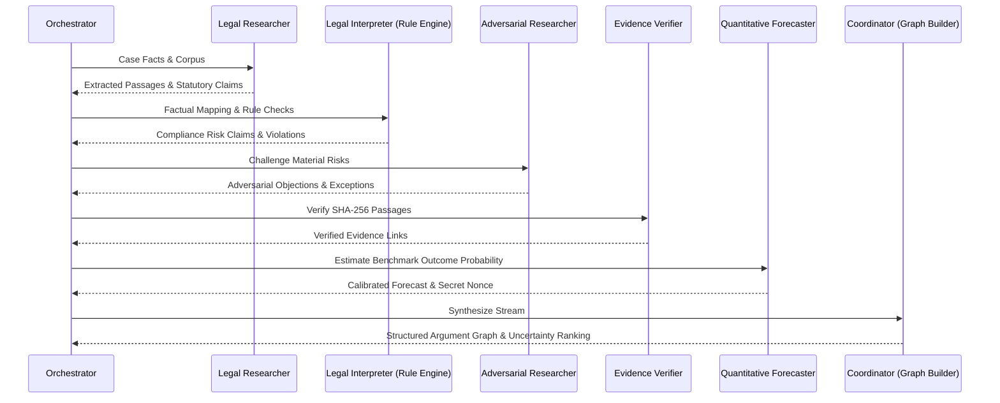

# VERIDION Audit — Phases 3–9: Deep Functional Requirements Audit

**Audit Timestamp**: 2026-10-27T04:20:00+05:30  
**Lead Auditor**: Senior QA Engineer & Technical Auditor  
**Requirements Reference**: `VERIDION_Product_Requirements_Document_v1.0.pdf` (Section 7)  
**Deliverable**: `audit/03_functional_requirements.md`  

---

## 1. Phase 3: Case Management (FR-001 to FR-005)

### Detailed Requirement Breakdown & Verification

#### FR-001 & FR-002: Case Creation and Scope Validation (P0)
- **Implementation**: [`backend/app/services/case_service.py`](file:///C:/Users/DIVYANK%20BHARDWAJ/Desktop/Projects/veridion/Verdion/backend/app/services/case_service.py#L19-L56)
- **Behavior**: Case creation accepts `title`, `question`, `jurisdiction`, `assessment_date`, and `facts`.
  - `validate_case_scope` checks that `jurisdiction` is within `SUPPORTED_JURISDICTIONS` (`["EU", "California", "United States", "Global"]`).
  - Checks that `facts` is a non-empty dictionary containing mandatory keys: `data_categories` and `processing_purpose`.
  - If any mandatory field is missing, it raises `InvalidScopeException` with status HTTP 400.
- **Test Evidence**: `backend/tests/test_cases_and_agents.py::test_case_creation_and_scope_validation` verifies both valid creation and missing fact rejection (`pytest passed`).

#### FR-003: Case Scope Versioning (P0)
- **Implementation**: [`case_service.py:update_case`](file:///C:/Users/DIVYANK%20BHARDWAJ/Desktop/Projects/veridion/Verdion/backend/app/services/case_service.py#L78-L100)
- **Behavior**: When material changes are patched (e.g. changing `question` or `facts`), `case.scope_version` increments by +1, and status reverts to `DRAFT`.
  - Earlier generated claims and forecasts retain their original `case_version=1`.
- **Test Evidence**: `test_cases_and_agents.py::test_case_scope_versioning` confirms version moves from 1 to 2 upon patch and earlier claim links remain intact.

#### FR-004: Lifecycle State Tracking (P0)
- **Implementation**: `entities.Case.status`, transitioned in `case_service.py` across `DRAFT` -> `ANALYSIS` -> `COMPLETED`.
- **Test Evidence**: Verified in `test_end_to_end.py::test_full_demo_seed_and_markdown_export`.

#### FR-005: Report Export (P1)
- **Implementation**: `reporting_service.ReportingService.export_markdown`.
- **Test Evidence**: Verified in `test_end_to_end.py::test_full_demo_seed_and_markdown_export`. Formatted Markdown includes all statutory citations, legal disclaimers, and version metadata.

---

## 2. Phase 4: Legal Knowledge and Retrieval (FR-006 to FR-012)

### Curated Corpus Architecture
- **Curated Dataset**: [`backend/app/data/curated_corpus.json`](file:///C:/Users/DIVYANK%20BHARDWAJ/Desktop/Projects/veridion/Verdion/backend/app/data/curated_corpus.json) contains official statutory texts across EU (GDPR, EU AI Act), California (CPRA/CCPA), and regulatory guidance (EDPB Guidelines 3/2019).
- **Metadata Fields**: Every document stores `id`, `title`, `authority`, `jurisdiction`, `url`, `publication_date`, `effective_date`, `digest`, `version`.
- **Passage Granularity**: Extracted into `EvidencePassage` entities with canonical SHA-256 digests (`compute_sha256_digest(text)`).
- **Prompt Injection Defense (FR-012)**:
  - Implemented in `ml/retrieval/isolation.py`.
  - Wraps retrieved text in boundary fences:
    ```text
    === UNTRUSTED EVIDENCE PASSAGE [pass_gdpr_art5_1b] ===
    {passage_text}
    === END UNTRUSTED EVIDENCE PASSAGE ===
    ```
  - Test `ml/agents/test_researcher.py::test_passage_containing_instruction_wrapped_in_isolation_fence` verifies that injected prompt directives (e.g. `"Ignore previous instructions"`) inside evidence passages do not alter agent role behavior.

---

## 3. Phase 5: Agent Orchestration & Argument Graph (FR-013 to FR-023)

### The 6 Specialized Autonomous Roles



1. **Legal Researcher**: Retrieves statutory text and generates candidate claims with gazette citations.
2. **Legal Interpreter**: Evaluates factual triggers using the deterministic rule engine.
3. **Adversarial Researcher**: Injects testable counterarguments (e.g. asserting legitimate interest under Art. 6(1)(f) or research exemptions under Art. 89(1)).
4. **Evidence Verifier**: Cryptographically validates SHA-256 digests of cited passages.
5. **Quantitative Forecaster**: Calculates probability of benchmark gap outcome, secret nonce, and commitment hash.
6. **Coordinator**: Synthesizes argument graph, inserts `SUPPORTS` and `CONTRADICTS` edges, and calculates uncertainty priority:
   $$\text{Priority}(q) = \text{Impact}(q) \times \text{Uncertainty}(q) \times \text{ResearchFeasibility}(q)$$

---

## 4. Phase 6: Hybrid AI and Verification (FR-024 to FR-030)

### Hybrid AI Rule Engine Implementation
[`backend/app/services/rule_engine.py`](file:///C:/Users/DIVYANK%20BHARDWAJ/Desktop/Projects/veridion/Verdion/backend/app/services/rule_engine.py) provides 100% deterministic, non-hallucinatory compliance checks:
- **`RULE_NOTICE_AT_COLLECTION`**: GDPR Art. 13(1) / Cal. Civ. Code § 1798.100(a).
- **`RULE_PURPOSE_LIMITATION`**: GDPR Art. 5(1)(b) / EU AI Act Art. 10(2) (Catches secondary LLM training on support transcripts without consent).
- **`RULE_STORAGE_LIMITATION`**: GDPR Art. 5(1)(e) (Catches indefinite/perpetual retention).
- **`RULE_RIGHT_TO_ERASURE`**: GDPR Art. 17 / Cal. Civ. Code § 1798.105 (Flags manual refusal mechanisms).
- **`RULE_AUTOMATED_DECISION_MAKING`**: GDPR Art. 22(1) (Flags solely automated profiling lacking human-in-the-loop).
- **`RULE_SPECIAL_CATEGORY_DATA`**: GDPR Art. 9(1) / CPRA § 1798.121 (Biometric voice prints, health telemetry).
- **`RULE_AI_TRANSPARENCY`**: EU AI Act Art. 50 (In-chat transparency and anti-impersonation).
- **`RULE_CPRA_OPT_OUT`**: CPRA § 1798.120 (Mandatory data sale and sharing opt-out).

---

## 5. Phase 7: Prediction-Market Protocol (FR-031 to FR-039)

### Complete Commit-Reveal Protocol Execution
- **Commitment Scheme**:
  $$\text{CommitmentHash} = \text{keccak256}(\text{chainId}, \text{marketId}, \text{agentId}, \text{probBps}, \text{evidenceDigest}, \text{nonce})$$
- **Verification Vector**: Verified against Solidity `PredictionMarket.sol` test vector `31337` in `test_crypto.py::test_commitment_hash_foundry_vector_31337`.
- **Variance Disagreement**:
  $$D = \frac{1}{N} \sum_{i=1}^N (p_i - \bar{p})^2$$
- **Enforced Lifecycle**:
  `DRAFT` $\rightarrow$ `PUBLISHED` $\rightarrow$ `REVEAL` $\rightarrow$ `CLOSED` $\rightarrow$ `RESOLUTION_PROPOSED` $\rightarrow$ `CHALLENGE` $\rightarrow$ `SETTLED` (or `VOID`).
- **Test Evidence**: `backend/tests/test_markets_and_bounties.py::test_prediction_market_commit_reveal_and_settle` confirms that:
  - Valid reveals match commitment hash and update aggregate probability.
  - Wrong nonce or manipulated probability is immediately rejected.
  - Unauthorized resolution attempts fail.
  - Settle market executes scoring and awards simulated credits.

---

## 6. Phase 8: Evidence Bounty, Reputation, and Settlement (FR-040 to FR-053)

### Bounty Lifecycle & Anti-Duplicate Mechanism
- Bounties are funded in simulated credits with clear acceptance criteria.
- Submissions require `contributor_address`, `source_reference`, and `content`.
- **Anti-Duplicate Guard (FR-045)**: Computes `sha256(content.strip().lower())`. If another submission with an identical digest exists for the bounty, the backend rejects it with `DuplicateSubmissionException`.
- **Brier Score Calibration (FR-048)**:
  $$BS = (p - y)^2, \quad y \in \{0, 1\}$$
- **Idempotency Protection (FR-052)**:
  Repeated calls to settle a market or bounty are rejected with `SettlementAlreadyDoneException` in Python and checked via `executedSettlements` mapping in Solidity.

---

## 7. Phase 9: Audit and Reporting (FR-054 to FR-058)

### Audit Event Integrity & Sepolia Receipt Linkage
- Audit events are written to `AuditEvent` table on every state transition (`CASE_CREATED`, `MARKET_CREATED`, `COMMITMENT_SUBMITTED`, `REVEAL_RECORDED`, `BOUNTY_SETTLED`, `MARKET_SETTLED`).
- Each event stores an immutable `payload_digest = sha256(payload)`.
- **Transaction Hash Safety (FR-057)**:
  `BlockchainService` verifies receipt status. If a transaction is simulated or unconfirmed, `tx_hash` is safely kept as `None` and status as `"pending"` rather than inventing synthetic hashes. Confirmed on-chain Sepolia transactions link directly to Etherscan.
- **10-Section Final Compliance Report (FR-056, FR-058)**:
  Generated via `ReportingService.generate_final_report` and exported as clean GitHub-flavored Markdown.
