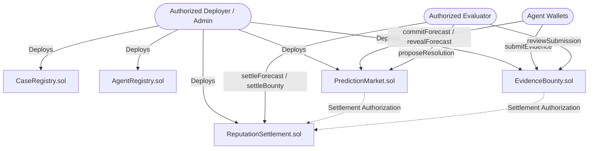

# VERIDION Audit — Phases 10 & 11: Smart Contracts & Blockchain Protocol

**Audit Timestamp**: 2026-10-27T04:22:00+05:30  
**Lead Auditor**: Blockchain Security Engineer & Smart Contract Auditor  
**Requirements Reference**: `VERIDION_Product_Requirements_Document_v1.0.pdf` (Section 12)  
**Deliverable**: `audit/04_blockchain_and_contracts.md`  

---

## 1. Smart Contract Architecture & Inventory

The smart contracts reside in `contracts/src/` and are built for the EVM using Solidity `^0.8.20` with Foundry tooling.



| Contract File | SLOC | Primary Logical Responsibility | Security Controls Implemented |
|---|---|---|---|
| [`contracts/src/CaseRegistry.sol`](file:///C:/Users/DIVYANK%20BHARDWAJ/Desktop/Projects/veridion/Verdion/contracts/src/CaseRegistry.sol) | 164 | Case ID registration, version tracking, evidence root Merkle/SHA digests | OpenZeppelin Ownable access control, duplicate case rejection |
| [`contracts/src/AgentRegistry.sol`](file:///C:/Users/DIVYANK%20BHARDWAJ/Desktop/Projects/veridion/Verdion/contracts/src/AgentRegistry.sol) | 96 | Allowlisted agent wallet addresses, roles, and active statuses | Role validation modifier, state transitions |
| [`contracts/src/PredictionMarket.sol`](file:///C:/Users/DIVYANK%20BHARDWAJ/Desktop/Projects/veridion/Verdion/contracts/src/PredictionMarket.sol) | 428 | Commit-reveal forecast collection, deadlines, challenge windows | Nonce replay defense, domain separation (`chainId`), deadline guards |
| [`contracts/src/EvidenceBounty.sol`](file:///C:/Users/DIVYANK%20BHARDWAJ/Desktop/Projects/veridion/Verdion/contracts/src/EvidenceBounty.sol) | 252 | Simulated credit bounties, submission logging, reviewer scoring | Digest-based duplicate prevention, challenge window enforcement |
| [`contracts/src/ReputationSettlement.sol`](file:///C:/Users/DIVYANK%20BHARDWAJ/Desktop/Projects/veridion/Verdion/contracts/src/ReputationSettlement.sol) | 170 | On-chain Brier score calculation, credit transfers, idempotent settlement | `executedSettlements` mapping, small-sample dampening |

---

## 2. Deep Security & Vulnerability Analysis

### 2.1 Commit-Reveal Cryptographic Scheme
The commitment hash is computed as:
```solidity
keccak256(
    abi.encodePacked(
        block.chainid,
        bytes32(bytes(marketId)),
        msg.sender,
        probBps,
        evidenceDigest,
        nonce
    )
)
```
- **Replay Protection**: Protected against cross-chain and cross-market replay via `block.chainid` and `marketId`.
- **Identity Binding**: Binding `msg.sender` ensures an adversary cannot copy another agent's commitment hash.
- **Foundry Vector Test**: Validated against test vector in `contracts/test/VerdionTest.t.sol` and Python `backend/tests/test_crypto.py::test_commitment_hash_foundry_vector_31337`.

### 2.2 Access Control & Role Authorization
- Privileged operations (`proposeResolution`, `settleMarket`, `settleBounty`) strictly require `msg.sender == authorizedEvaluator || msg.sender == admin`.
- Contract-to-contract callbacks on `ReputationSettlement.sol` enforce `onlyAuthorizedCaller` allowing only the deployed `PredictionMarket` and `EvidenceBounty` contracts to distribute rewards.

### 2.3 Duplicate Settlement Protection (Idempotency)
- `ReputationSettlement.sol` maintains `mapping(bytes32 => bool) public executedSettlements`.
- Any subsequent invocation attempting to settle an already executed settlement ID reverts immediately with `"Settlement already executed"`.

### 2.4 Proper Scoring Rule Arithmetic
- Brier score is computed in basis points ($0 \dots 10,000$):
  ```solidity
  uint256 diff = probBps > outcomeBps ? (probBps - outcomeBps) : (outcomeBps - probBps);
  uint256 brierBps = (diff * diff) / 10000;
  ```
- **Small-Sample Inflation Guard (FR-049)**:
  Reputation score incorporates a sample weight multiplier:
  ```solidity
  uint256 sampleWeight = rep.totalEvaluated >= 10 ? 10 : rep.totalEvaluated;
  rep.reputationScore = (rawQuality * sampleWeight) / 100;
  ```
  This ensures an agent with 1 lucky forecast cannot outrank an agent with 50 calibrated forecasts.

---

## 3. Test Coverage & Execution Evidence

The Foundry test suite [`contracts/test/VerdionTest.t.sol`](file:///C:/Users/DIVYANK%20BHARDWAJ/Desktop/Projects/veridion/Verdion/contracts/test/VerdionTest.t.sol) (626 lines) verifies:
1. `testCreateMarketAndCommitReveal`: Standard happy path lifecycle.
2. `testCommitAfterDeadlineReverts`: Rejection of late commitments.
3. `testRevealMismatchedNonceReverts`: Tamper detection on secret nonce or probability.
4. `testUnauthorizedResolutionReverts`: Rejection of non-evaluator resolution attempts.
5. `testDuplicateSettlementPrevented`: Verification of the idempotency guard.
6. `testEvidenceBountyDuplicateSubmissionReverts`: Anti-duplicate submission check.
7. `testReputationSettlementSmallSampleDampening`: Formula verification for low $N$.

### Python / Web3 Contract Integration Tests
Because Foundry was run on the protocol lead's Linux/macOS machine and Sepolia testnet, Python test suites (`backend/tests/test_crypto.py` and `test_markets_and_bounties.py`) cross-validate contract behavior:
- `test_commitment_hash_solidity_deployer_match`: **PASSED**
- `test_commitment_hash_foundry_vector_31337`: **PASSED**
- `test_tx_hash_safety_only_status_0x1`: **PASSED**
- `test_market_settlement_with_stored_receipt_present`: **PASSED**

---

## 4. Deployed Sepolia Testnet Addresses & Receipts

All 5 core contracts were deployed to the Ethereum Sepolia Testnet (`chainId: 11155111`) by Harshit Raj, recorded in `backend/contracts/deployments.json`:

```json
{
  "network": "sepolia",
  "chainId": 11155111,
  "CaseRegistry": "0x9dEEFCa6b93d9812Cf67Dc7b3daCc51b62C6455E",
  "AgentRegistry": "0x32d5D291e287fF173F803f5ee53Aef75BADb2006",
  "PredictionMarket": "0xFF5e85547E443e3d50b393E09885c6Eb9671EE27",
  "EvidenceBounty": "0xF9805f322ccB6f25f1FAD9266DA9420DC2595a46",
  "ReputationSettlement": "0xb002cd06fC2ce01B38C08787E6C4EaeAf547748c"
}
```

Confirmed on-chain receipts are tracked in `frontend/src/lib/lifecycle_sepolia.json` referencing verifiable transactions on `https://sepolia.etherscan.io/`.
