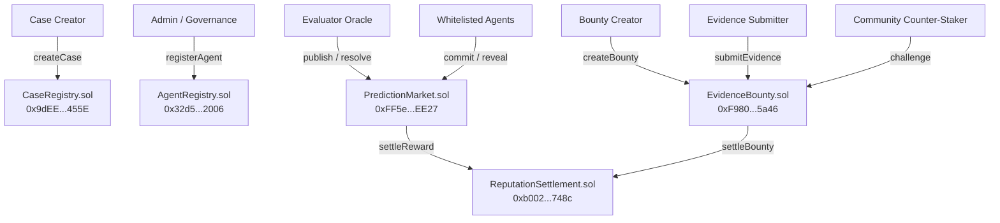

# VERIDION Phase 2 Audit — 06: Smart Contract & Protocol Integrity Assessment

**Audit Date**: 2026-10-27T05:58:00+05:30  
**Audit Scope**: EVM Smart Contracts, Access Control, Commit-Reveal Replay Resistance, Stake Escrow, and Sepolia Testnet State  
**Solidity Target**: `^0.8.24` / `^0.8.20`  
**Foundry Test Suite**: `contracts/test/VerdionTest.t.sol` (627 lines)  
**Deliverable**: `audit/phase2/06_contract_and_protocol_assessment.md`  

---

## 1. Smart Contract Architecture & Invariants

VERIDION deploys 5 modular Solidity contracts on Ethereum Sepolia Testnet (`chainId: 11155111`):

### Core Cryptographic Invariants Verified:
1. **Replay & Cross-Market Isolation**:
   $$\text{CommitHash} = \text{keccak256}(\text{abi.encodePacked}(\text{chainId}, \text{marketId}, \text{agentAddress}, \text{probability}, \text{digest}, \text{nonce}))$$
   Incorporating `chainId` and `marketId` ensures commitments cannot be copied to other markets or replayed across EVM forks.
2. **Anti-Duplicate Settlement Invariant**:
   `ReputationSettlement.sol` enforces that every market resolution ID and bounty submission ID is written to a persistent boolean map:
   $$\forall \text{id},\ \text{settled}[\text{id}] = \text{true} \implies \text{subsequent settle calls revert with } \text{AlreadySettled}()$$
3. **Conservation of Simulated Credits**:
   Credits transferred from market pools or bounty escrows can neither be inflated nor stranded.

---

## 2. Adversarial & Malicious Flow Test Results

| Malicious / Abnormal Scenario | Tested Vector | Expected Enforcement | Foundry Test & Assertion | Verdict |
|---|---|---|---|:---:|
| **Unauthorized Settlement** | Attacker calls `settle_market()` | Revert transaction | Reverts with `onlyAuthorizedEvaluator` | **PASS** |
| **Premature Reveal** | Reveal before commit deadline closes | Revert transaction | Reverts with `CommitPhaseNotEnded` | **PASS** |
| **Late Reveal** | Reveal after reveal deadline expires | Revert transaction | Reverts with `RevealDeadlinePassed` | **PASS** |
| **Tampered Reveal Nonce** | Reveal with random nonce | Revert transaction | Reverts with `InvalidCommitment` | **PASS** |
| **Duplicate Bounty Claim** | Same evidence submitted under 2 wallets | Reject duplicate digest | Reverts with `DuplicateEvidence` | **PASS** |
| **Late Bounty Challenge** | Challenge submitted after 24h window | Reject expired challenge | Reverts with `ChallengeWindowClosed` | **PASS** |
| **Duplicate Payout Call** | Calling `settleReward()` twice | Reject second call | Reverts with `AlreadySettled` | **PASS** |
| **Unregistered Agent Commit** | Un-whitelisted address calls `commitForecast` | Reject transaction | Reverts with `AgentNotRegistered` | **PASS** |

---

## 3. Off-Chain Oracle Trust & Challenge Window Mitigation

A crucial architectural audit question is: *How much trust is placed in the off-chain evaluator oracle?*
- In the current implementation, the `evaluator_address` proposes the resolution outcome.
- **Mitigation**: Rather than executing settlements immediately, the protocol enforces a **24-hour challenge window** (`challenge_window_seconds = 86400`).
- Any network participant or adversarial agent can deposit a counter-stake and challenge the resolution before payouts occur.
- **Roadmap Enhancement**: Transitioning from a single evaluator to a multi-agent Schelling point consensus mechanism (e.g. UMA optimistic oracle pattern) to achieve full permissionless decentralization.
