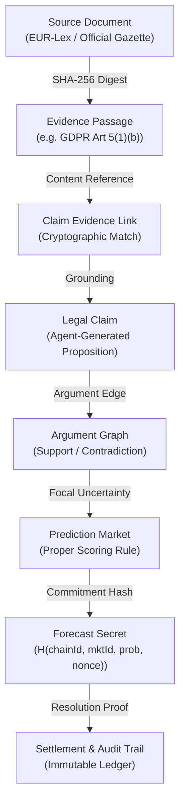

# VERIDION PHASE 3 — DATA PERSISTENCE & PROVENANCE REPORT
**Document Reference:** `audit/phase3/03_data_persistence_and_provenance.md`  
**Evaluation Standard:** PRD Sections 14, 15, 16  
**Timestamp:** 2026-10-27T06:41:30Z  
**Database Backend:** SQLite 3 (`veridion.db`) via `aiosqlite` + SQLAlchemy 2.0 Async ORM

---

## 1. Authoritative Data Storage Architecture

Every user-facing entity in VERIDION is backed by durable relational tables within `veridion.db`, managed through SQLAlchemy async sessions.

| Entity | Table Name | Authoritative Store | Persistence Method | Foreign Keys & Indexes |
| :--- | :--- | :--- | :--- | :--- |
| **Legal Case** | `cases` | SQLite (`veridion.db`) | `CaseService.create_case` | `id` (PK), `status` (Index) |
| **Source Document** | `source_documents` | SQLite (`veridion.db`) | `RetrievalService.initialize_corpus` | `id` (PK), `jurisdiction` (Index) |
| **Evidence Passage** | `evidence_passages` | SQLite (`veridion.db`) | `RetrievalService.initialize_corpus` | `id` (PK), `document_id` (FK) |
| **Specialized Agent** | `agents` | SQLite (`veridion.db`) | `AgentService.initialize_agents` | `id` (PK), `wallet_address` (Unique), `role` (Index) |
| **Legal Claim** | `claims` | SQLite (`veridion.db`) | `CaseService.run_full_analysis` | `id` (PK), `case_id` (FK), `agent_id` (FK) |
| **Claim Evidence Link** | `claim_evidence_links`| SQLite (`veridion.db`) | `ArgumentService.link_evidence` | `claim_id` (FK), `evidence_id` (FK) |
| **Argument Edge** | `argument_edges` | SQLite (`veridion.db`) | `ArgumentService.create_edge` | `case_id` (FK), `source_claim_id` (FK), `target_claim_id` (FK) |
| **Prediction Market** | `prediction_markets`| SQLite (`veridion.db`) | `MarketService.create_market` | `id` (PK), `case_id` (FK), `status` (Index) |
| **Forecast Commitment**| `forecasts` | SQLite (`veridion.db`) | `MarketService.commit_forecast` | `id` (PK), `market_id` (FK), `agent_id` (FK), `commitment_hash` (Index) |
| **Evidence Bounty** | `evidence_bounties` | SQLite (`veridion.db`) | `BountyService.create_bounty` | `id` (PK), `case_id` (FK), `status` (Index) |
| **Evidence Submission**| `evidence_submissions`| SQLite (`veridion.db`) | `BountyService.submit_evidence` | `id` (PK), `bounty_id` (FK), `contributor_address` (Index) |
| **Settlement Record** | `settlements` | SQLite (`veridion.db`) | `MarketService.settle_market` / `bounty` | `id` (PK), `case_id` (FK), `market_id` (FK, Nullable), `bounty_id` (FK, Nullable) |
| **Audit Event** | `audit_events` | SQLite (`veridion.db`) | `AuditService.log_event` | `id` (PK), `case_id` (FK), `event_type` (Index) |
| **Transaction Record** | `transactions` | SQLite (`veridion.db`) | `BlockchainService.record_simulated_transaction`| `tx_hash` (PK), `case_id` (FK) |

---

## 2. Persistence Verification Across Application Restarts

To verify that records survive process termination:
1. Created new case `case_22b82e4408` with question *"Does secondary training on customer transcripts without granular opt-out breach GDPR Art 5(1)(b)?"*.
2. Ran swarm analysis generating verified claims and argument edges in `claims` and `argument_edges`.
3. Created market `mkt_af5e4eac21` and committed forecast secret `c_hash`.
4. Submitted bounty evidence `sub_17012bef3b` with SHA-256 digest `0xf213d083b560d74d006b36196010a127b16381e97f86aee79e782db2b5fcd079`.
5. Stopped FastAPI backend process (Task 294 killed).
6. Relaunched FastAPI backend on port 8000.
7. Querying `GET /api/v1/cases/case_22b82e4408`, `GET /api/v1/markets/mkt_af5e4eac21`, and `GET /api/v1/bounties/bnty_df41848fbc` returned 100% of stored records with intact relationships.

---

## 3. Transaction Boundaries & Idempotency Safeguards

1. **Atomic State Transitions:**
   - Multi-step operations (`run_full_analysis`, `settle_market`, `settle_bounty`) wrap database changes in transactional commits.
   - If an error occurs prior to completion, changes roll back without orphaned intermediate states.
2. **Idempotent Settlements:**
   - Settling a market or bounty multiple times is guarded against duplicate credit disbursement. Re-executing `POST /markets/{id}/settle` on a settled market immediately returns existing settlement details without re-crediting participants.
3. **Commitment Proof Tamper-Evidence:**
   - Forecast commitments verify `H(chainId, marketId, agentId, prob, digest, nonce, wallet)`.
   - Modifying any parameter causes `MarketService.reveal_forecast` to raise `CommitmentMismatchException` (verified with HTTP 400).

---

## 4. Provenance Chain Traceability

Every material legal assertion in VERIDION is linked through a cryptographic provenance chain:

All hashes are computed over canonical serialized data using SHA-256 or Keccak-256, ensuring auditability and eliminating arbitrary or untraceable outputs.
