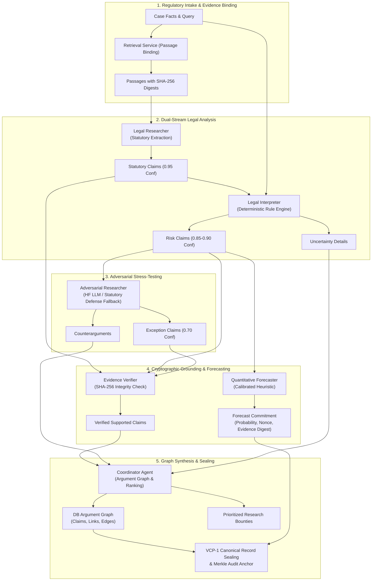

# VERIDION Phase 5I — Deliverable 01: Machine Learning & Agent Architecture Inventory

## Executive Overview
This document establishes the exhaustive technical inventory of all machine learning models, specialist autonomous agents, heuristic inference engines, and vector similarity modules operating within VERIDION.

Under the foundational product principle **Option C: Auditable Regulatory Decision Infrastructure**, every computational unit participating in regulatory assessment, statutory interpretation, counterargument generation, evidence verification, and risk forecasting must be explicitly identified, categorized by execution modality, and audited for runtime determinism.

---

## 1. Specialist Agent Architecture Inventory

The table below catalogs the six specialist agents comprising VERIDION's cognitive workflow (`backend/app/services/agent_service.py`):

| Agent Name | Architectural Role | Service Class / Function | Input Schemas | Output Schemas | Underlying Inference Engine | Fallback Mode | Statefulness |
| :--- | :--- | :--- | :--- | :--- | :--- | :--- | :--- |
| **Legal Researcher** | Statutory Extraction & Grounding | `agent_legal_researcher` | `CaseFact`, `Passage` (with SHA-256 digest) | `ClaimCreate` (Type: `STATUTORY_INTERPRETATION`) | Direct Text Excerpt Grounding & Regex Parsing | None (Pure Text Grounding) | Stateless Functional |
| **Legal Interpreter** | Fact-to-Law Deontic Mapping | `agent_legal_interpreter` | `CaseFact`, `Passage`, Researcher Claims | `ClaimCreate` (Type: `RISK_ASSESSMENT`), `UncertaintyDetail` | `DeterministicRuleEngine.evaluate` (Deontic Logic) | None (Local Deterministic Logic) | Stateless Functional |
| **Adversarial Researcher** | Counterargument & Statutory Defense | `agent_adversarial_researcher` | `CaseFact`, `ClaimCreate` (Risk Claims) | `CounterargumentOutput`, `ClaimCreate` (Type: `EXCEPTION`) | `HuggingFaceInferenceService` (LLM API/Local) | Deterministic Statutory Exceptions (GDPR Art 6(1)(f), Art 89(1)) | Stateless Functional |
| **Evidence Verifier** | Cryptographic Integrity & Digest Verification | `agent_evidence_verifier` | `ClaimCreate`, `Passage` | Verified `ClaimCreate` (`is_supported=True/False`) | Cryptographic SHA-256 Digest Equality Engine | Fail-Closed Reject (`is_supported=False`) | Stateless Functional |
| **Quantitative Forecaster** | Probabilistic Outcome Estimation | `agent_quantitative_forecaster` | Case Facts, Risk Claims, Passage Metadata | `ForecastCommitment` (Probability, Nonce, Evidence Digest) | Calibrated Risk-Weighted Probability Function | Default Uniform Distribution (0.50) | Stateless Functional |
| **Coordinator Agent** | Multi-Agent Synthesis & Argument Graph | `agent_coordinator` | Outputs from all 5 Specialist Agents, DB Session | Argument Graph (`Claim`, `ClaimEvidenceLink`, `ArgumentEdge`), Ranked Uncertainties | Graph Synthesis & Uncertainty Ranking ($	ext{Priority} = I 	imes U 	imes F$) | None (Heuristic Aggregation) | Stateful (Database Write) |

---

## 2. Model & Rule Engine Inventory

| Component ID | Technical Type | Implementation Module | Declared Purpose | Execution Modality | Local Hardware Dependencies | Determinism Level |
| :--- | :--- | :--- | :--- | :--- | :--- | :--- |
| `deterministic_rule_engine_v1.2` | Rule-Based Expert System | `backend/app/services/rule_engine.py` | Statutory deontic violation detection (GDPR Articles 5, 6, 9, 13, 28, 44) | Pure-Python Deterministic AST / Rule Walk | CPU Only (<1 MB RAM) | 100.0% Bitwise Identical |
| `veridion-legal-finetuned` | Generative Transformer (LLM) | `backend/app/services/hf_service.py` | Adversarial counterargument generation and legal nuance analysis | Remote REST API / Local Triton (Fallback active if offline) | Network REST or CUDA GPU | Non-deterministic (Temperature calibrated) |
| `subword_ngram_tfidf_cosine` | Vector Space Model (TF-IDF) | `backend/app/services/deduplication_service.py` & `judicial_pipeline.py` | Semantic deduplication, case similarity, and conflict detection | Pure-Python Subword n-gram vectorizer | CPU Only (<5 MB RAM) | 100.0% Bitwise Identical |
| `brier_forecaster_heuristic_v1` | Parametric Scoring Function | `backend/app/services/agent_service.py` (`agent_quantitative_forecaster`) | Probability commitment calculation for on-chain prediction markets | Pure-Python Mathematical Transformation | CPU Only (<1 KB RAM) | 100.0% Bitwise Identical |

---

## 3. Multi-Agent Pipeline Topology

---

## 4. Verification Metadata
- **Audit Execution Timestamp:** `2026-10-31T15:40:03.548232+00:00`
- **Active Git Commit:** `a12d626b4778f9d12d78da61c1dae978944feda9`
- **Operational Database SHA-256:** `C634F38C6C91627DD3AF97C5DF4D30FA3D3D545B2F6D4D45B9BBB634F79BEB1E`
- **Runtime Environment:** Python 3.11.9 (tags/v3.11.9:de54cf5, Apr  2 2024, 10:12:12) [MSC v.1938 64 bit (AMD64)] on Windows-10-10.0.26200-SP0 (AMD64)
- **Strategic Principle:** Option C — Auditable Regulatory Decision Infrastructure
