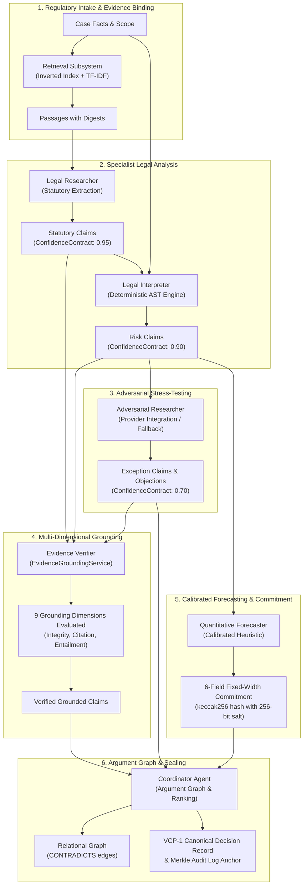

# VERIDION Phase 5J — Deliverable 16: Updated Agent, ML & Grounding Architecture

## Executive Summary
This document provides the authoritative architectural blueprint for VERIDION following Phase 5J enhancements.

---

## 1. Updated Architectural Topology

